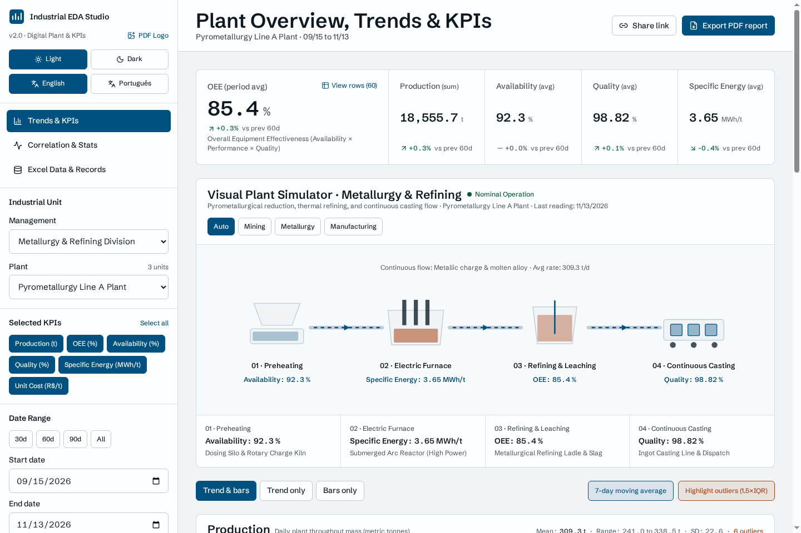
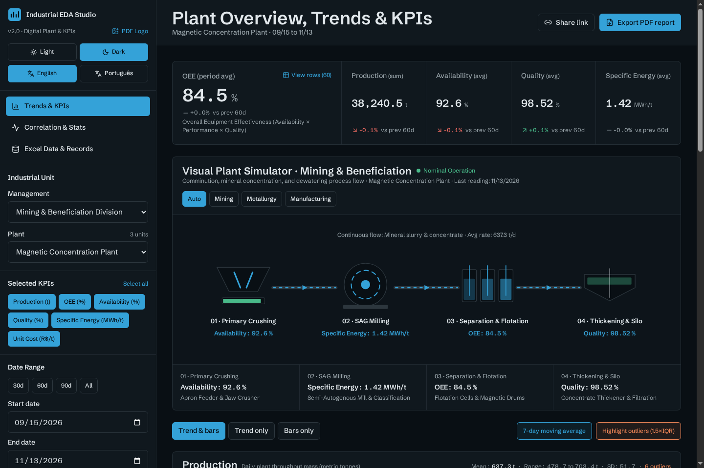
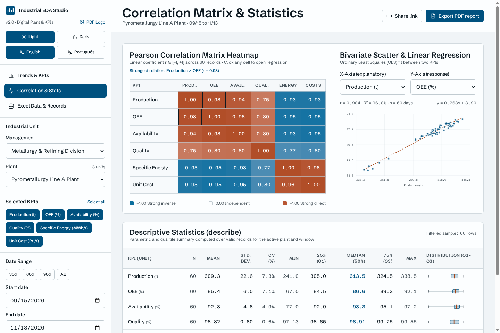
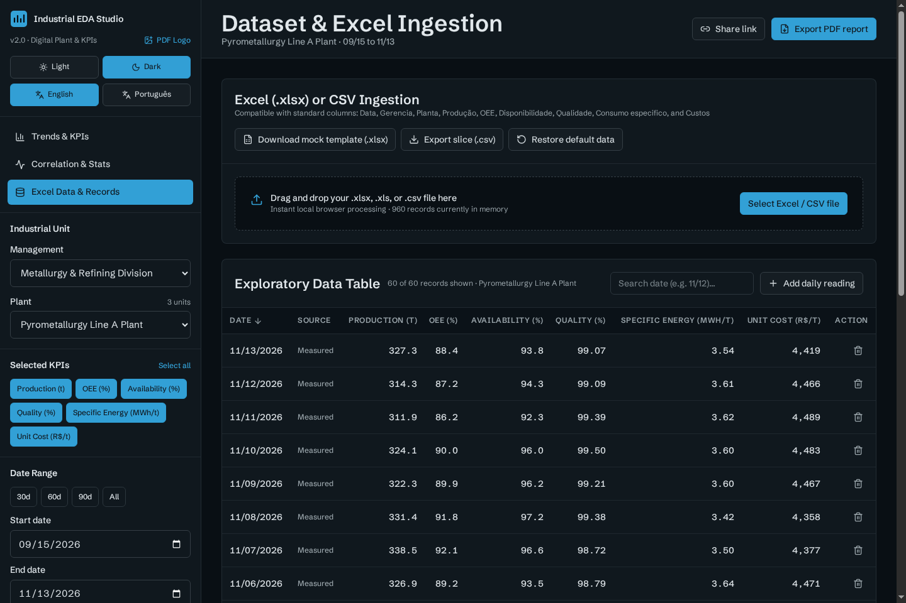

# Industrial EDA Studio — Dynamic Exploratory Data Analysis & Plant Simulator

> This Version of the **Industrial Exploratory Data Analysis (EDA)** web platform built with **React 19, TypeScript, Vite, and Tailwind CSS**, featuring a dynamic SVG industrial plant visual simulator, real-time KPI monitoring, statistical diagnostics, Excel ingestion, and PDF executive reporting.
>
> - **Repository**: `https://github.com/lucasgabrieleng/Industrial_EDA_v2`
> - **Live App (GitHub Pages)**: `https://lucasgabrieleng.github.io/Industrial_EDA_v2/`

## Overview

Industrial engineering teams frequently rely on Excel spreadsheets and static scripts to inspect production stability, Overall Equipment Effectiveness (OEE), specific energy consumption, and unit costs. This script transforms a multi-iteration Python/Streamlit EDA workflow into a fast, client-side **React + TypeScript** analytical workspace combining an interactive industrial process schematic with live telemetry and statistical diagnostics.

## Application Snapshots

### 1. Overview Dashboard & Metallurgy Plant Simulator (Light Mode)


### 2. Mining & Beneficiation Plant Simulator (Dark Mode)


### 3. Pearson Correlation Heatmap, OLS Regression & Descriptive Statistics


### 4. Excel / CSV Ingestion & Exploratory Data Table (Dark Mode)


## Key Features

- **Interactive Industrial Plant Simulator (v2.0)**: Dynamically renders a sector-specific 4-stage SVG process schematic inside the **Trends & KPIs** overview dashboard—adapting between **Mining & Beneficiation** (Crushing → SAG Milling → Flotation → Thickening), **Metallurgy & Refining** (Preheating → Electric Furnace → Refining → Continuous Casting), and **Manufacturing & Materials** (Dosing → Thermal Sintering → CNC Machining → Inspection)—with live operational health states, animated material flow, and click-to-focus KPI linkages.
- **Correlated Hierarchy Filtering**: Dynamic Management → Plant cascading selectors, multi-select KPI toggles, and quick date-range windows (`30d`, `60d`, `90d`, `All`, or custom range).
- **Dynamic KPI Trends & Distributions**: Interactive SVG time-series trend lines (with 7-day rolling mean and $1.5 \times \text{IQR}$ Tukey outlier highlighting) paired with zero-baseline daily bar charts and period-over-period comparisons.
- **Real-Time Shift Telemetry Simulator**: Stream live operational shift readings every 2 seconds to observe dynamic recalculation of plant flow rates, trends, descriptive statistics, and correlations.
- **Pearson Correlation Heatmap & OLS Regression**: Clickable diverging correlation matrix (`coolwarm` scale) coupled with an interactive bivariate scatter plot and Ordinary Least Squares regression line ($r$, $R^2$, equation).
- **Complete Descriptive Statistics (`describe()`)**: Count, mean, sample standard deviation ($n-1$), coefficient of variation (CV%), min, quartiles (`Q1`, median, `Q3`), max, and inline SVG boxplots.
- **Excel (`.xlsx` / `.xls`) & CSV Ingestion**: Drag-and-drop spreadsheet upload via SheetJS (`xlsx`), downloadable mock Excel template (`Industrial_KPIs_Mock_Data.xlsx`), manual daily record entry, and delete/undo actions persisted in `localStorage`.
- **Light & Dark Themes (`?theme=light` / `?theme=dark`)**: Instant switching between high-contrast **Light** and **Dark** control-room palettes, persisted locally and preserved in shareable URLs so both visual modes can be published and showcased.
- **Bilingual UI (`English` / `Português`, `?lang=en` / `?lang=pt`)**: Built-in language switcher button in the sidebar translating all views, industrial plant schematics, charts, date/number formats, and PDF reports between English (default) and Portuguese.
- **Branded Multi-Page PDF Export & Shareable URLs**: Generate executive PDF reports (with optional custom logo upload, descriptive stats table, correlation heatmap, and KPI charts) and copy shareable filter state URLs.

## Mock Dataset Schema

The built-in simulator seeds **960 daily records** across **3 management units** and **8 industrial plants** with the following schema:

| Column | Type | Unit / Description |
| :--- | :--- | :--- |
| `Data` | Date (`YYYY-MM-DD`) | Daily operational date |
| `Gerencia` | String | Industrial management unit |
| `Planta` | String | Plant or production line |
| `Produção` | Number | Daily output (`t`) |
| `OEE` | Number | Overall Equipment Effectiveness (`%`) |
| `Disponibilidade` | Number | Operational availability (`%`) |
| `Qualidade` | Number | First-pass yield (`%`) |
| `Consumo especifico` | Number | Specific energy consumption (`MWh/t`) |
| `Custos` | Number | Unit transformation cost (`R$/t`) |

## Getting Started Locally

```bash
# Install dependencies
npm install

# Run development server on http://localhost:3000
npm run dev

# Type-check and build for production
npm run lint
npm run build
```

## Tech Stack

- **Frontend**: React 19, TypeScript, Tailwind CSS v4, Lucide Icons, Motion
- **Data & Reporting**: SheetJS (`xlsx`), jsPDF, `jspdf-autotable`
- **Build Tool**: Vite
